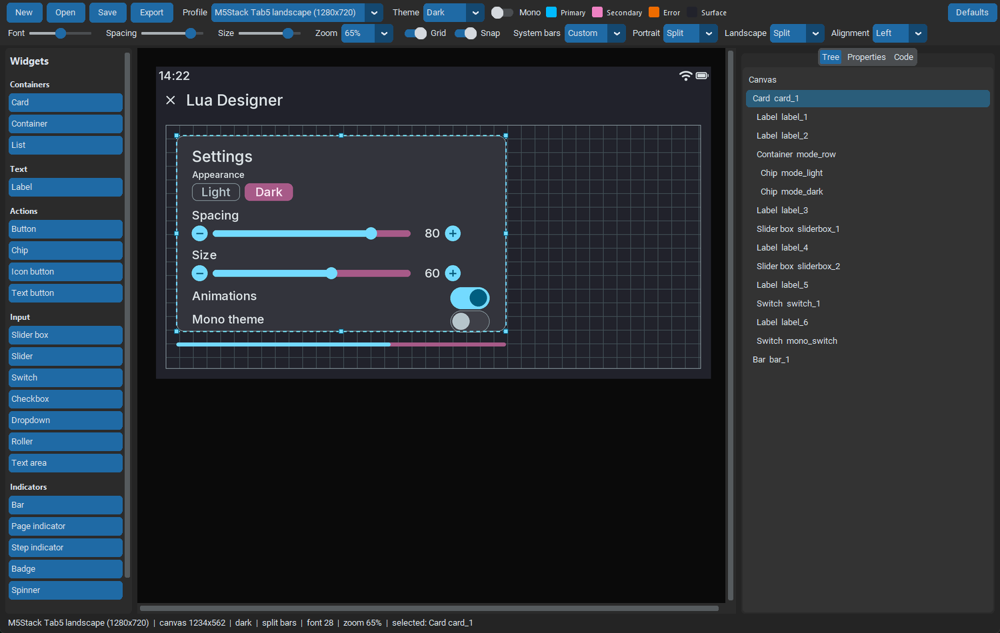
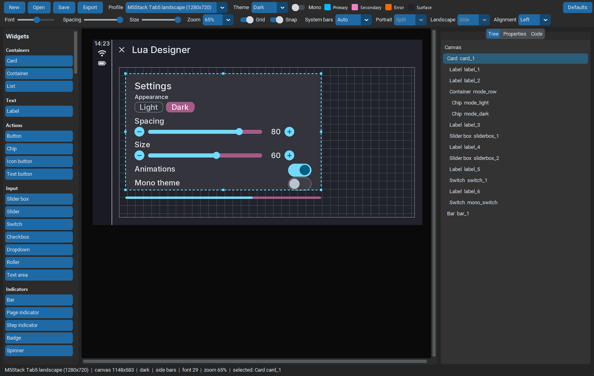
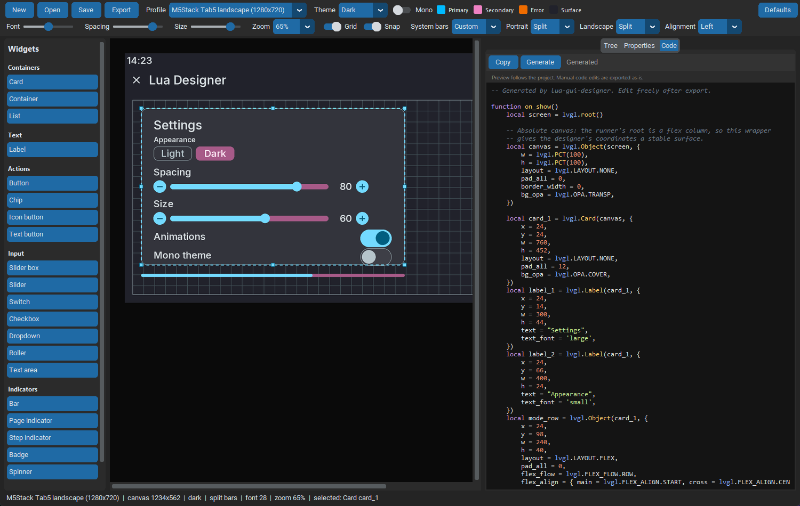
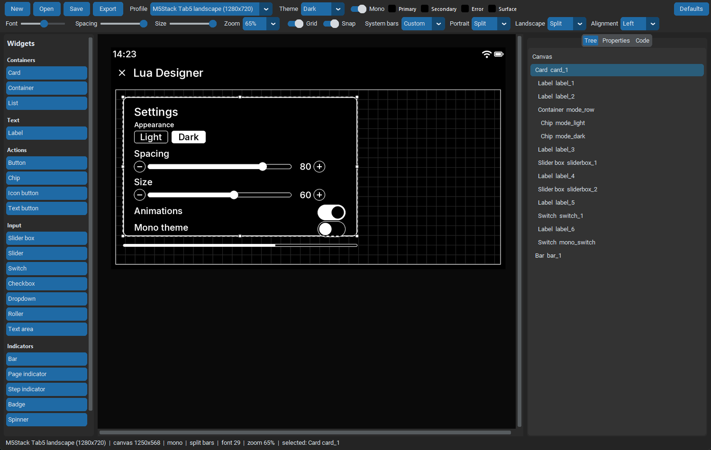

# Lua GUI Designer









A desktop designer for Tactility's `luavgl` scripts. It edits a project, renders
a themed preview at a real device resolution, and exports a normal Lua script
with empty event handlers to fill in later.

This is a PC tool. It does not connect to the device; the exported `.lua` file
is run with the Lua app or packaged as a Lua app.

## Requirements

- Python 3.10+
- [Custom2kinter](https://pypi.org/project/custom2kinter/) 6.x
  (`pip install custom2kinter`)
- Pillow (Custom2kinter depends on it; the preview renderer uses it too)

Custom2kinter is the maintained fork of CustomTkinter; the module name is still
`customtkinter`.

## Run

```powershell
py Apps\LuaRuntime\tools\lua-gui-designer\designer.py
```

Useful non-GUI modes:

```powershell
# Model, theme-geometry, JSON round-trip and export assertions
py Apps\LuaRuntime\tools\lua-gui-designer\designer.py --self-test

# Drive the real Tk window through every control, widget and property
py Apps\LuaRuntime\tools\lua-gui-designer\designer.py --ui-test

# Write the demo project as Lua
py Apps\LuaRuntime\tools\lua-gui-designer\designer.py --demo-export demo.lua

# Open the Appearance Settings clone project
py Apps\LuaRuntime\tools\lua-gui-designer\designer.py --open Apps\LuaRuntime\tools\lua-gui-designer\appearance.luadesign.json

# Open the window, capture it, and exit (smoke test)
py Apps\LuaRuntime\tools\lua-gui-designer\designer.py --screenshot shot.png

# Same, with a simulator profile and the device's appearance settings
py Apps\LuaRuntime\tools\lua-gui-designer\designer.py --profile tab5-landscape --appearance 80,80,28 --bars custom --landscape-layout split --screenshot shot.png

# Monochrome theme preview
py Apps\LuaRuntime\tools\lua-gui-designer\designer.py --profile cl-32 --mono --screenshot mono.png

# Surface override and system-bars alignment
py Apps\LuaRuntime\tools\lua-gui-designer\designer.py --surface "#3a1a1a" --align right --screenshot shot.png

# Maximized window (useful for checking palette/tree scrolling)
py Apps\LuaRuntime\tools\lua-gui-designer\designer.py --maximized --screenshot shot.png
```

`--appearance` takes `spacing,size,font-size` exactly like the Appearance
settings; use it to reproduce a particular device.

`--ui-test` needs a desktop session, but it does not need a human: it changes
profiles, themes, bars layouts and colours, adds every widget, edits every
property type, invokes every switch and button callback, and saves/exports the
project.

## What it does

- **Profiles**: the seven firmware simulator profiles — Default, CL-32,
  LilyGO T-Deck, LilyGO T-Lora Pager, M5Stack Cardputer, M5Stack Tab5 and
  Sixrig myPuter — plus landscape/portrait Tab5 and myPuter variants. Each
  profile carries its display size, DPI, default font size and default
  spacing/size, matching `Devices/simulator/Source/SimulatorProfile.cpp`.
- **Theme preview**: the Material and material-mono roles from
  `themes/material.lss` and `themes/material_mono.lss`, with a Dark/Light
  switch and a Mono switch. Spacing, size and font-size sliders mirror the
  Appearance settings. **Defaults** restores the profile's appearance values.
  Mono displays force the mono theme and disable the colour swatches, just like
  the Appearance app.
- **Colours**: **Primary**, **Secondary**, **Error** and **Surface** each show a
  name next to a colour square, like the Appearance app. Secondary drives
  selected chips, bars, badges and step progress; error drives out-of-bounds
  warnings and error states; surface drives the app background and the derived
  container tones. Right-click **Surface** to clear the override.
- **Chrome**: the status bar and toolbar are part of the preview. Their heights
  use the same formulas as `statusbar.cpp` and `toolbar.cpp`, and the content
  inset uses LVGL's `LV_DPX_CALC` conversion, so the canvas position matches a
  device with the same profile and appearance settings.
- **System bars**: **System bars** switches between the firmware's `auto` and
  `custom` modes; **Portrait** and **Landscape** choose split/side for each
  orientation, and **Alignment** moves the strip or split-layout actions
  left/right. The preview draws both the split status bar/toolbar and the side
  strip.
- **Palette**: a searchable, two-column component grid grouped by category:
  Card, Container, Label, Button, Chip, SliderBox, Spinbox, Slider, Switch,
  Checkbox, Dropdown, Roller, TextArea, Arc, Line, LED, Scale, ImageButton,
  Tabs, Statusline, Bar, List, PageIndicator, StepIndicator, Badge, Spinner,
  Image, IconButton, TextButton, Table, Chart, Calendar, Keyboard, Button
  matrix, Tab view and Tile view. **Search widgets** filters by title or type;
  **Esc** clears it.
- **Table and chart data**: the Table fields are `rows`, `columns`, optional
  column widths and one `cell | cell` line per row. Chart takes a chart type, a
  point count and a comma-separated value series. Calendar edits the today/shown
  dates and day names; Keyboard picks a mode; Button matrix takes one
  comma-separated row per line.
- **Tab view and tile view**: a child has a **Tab** or **Tile** field (shown when
  its parent is one of these widgets); it defaults to the parent's active page.
  The preview draws only the active page, while the export puts every child in
  its assigned tab/tile. Switch `active_tab`/`active_tile` to inspect another
  page; children with no explicit page follow it.
- **Icons**: the toolbar **Icons** button opens a searchable grid of the shared
  Material Symbols and copies `lvgl.ICON.NAME`. The Tabs content editor has its
  own **Icon...** button that inserts `NAME|` at the cursor.
- **Canvas**: click to select, Shift+click to add or remove a widget from a
  multi-selection, drag, resize with 8 handles, snap to an 8 px grid, delete,
  duplicate, nudge with arrow keys. Delete and the arrow keys act on every
  selected widget. Right-click opens Duplicate/Delete and, with two or more
  selected, Align Left/Center/Right/Top/Middle/Bottom and Distribute
  Horizontally/Vertically. Widgets outside the canvas get a red dashed warning,
  and the status line counts them. Keyboard: **Ctrl+Z** undo, **Ctrl+Y** or
  **Ctrl+Shift+Z** redo, **Ctrl+D** duplicate, **Delete** remove.
- **Hierarchy**: the **Tree** tab is the first panel. Use the arrow to
  collapse/expand a container. **Filter widgets** narrows the tree to matching
  widgets and their ancestors and temporarily expands the matches. Right-click a
  row to rename, duplicate, delete, move to Canvas, move out one level, or
  change the z-order. Drag a row onto a container to reparent it, or onto a
  sibling to reorder it; drop on empty space or **Canvas** to remove its parent.
- **Properties**: a **Name** field at the top renames the widget's generated
  Lua variable (letters, digits and underscores only). Text fields on Label,
  Button, TextButton, IconButton, Chip and Checkbox have an **Icon...** button
  that fills in `lvgl.ICON.NAME` and selects the `icon` font. Below the name:
  geometry, colours, fonts, text alignment, long mode, values, options, event
  snippets. Radius and border width are optional: leave them empty (or press
  **Theme**) to inherit the firmware's shape, or set explicit pixels. Chip has
  its own background, border and selected-state colours. The schema lives in
  `widgets.py`. Selecting a widget on the canvas switches to this tab.
- **Layout**: absolute x/y plus pixel, percentage (`Width %`, `Height %`) or
  content (`Width = content`, `Height = content`) width/height; content-sized
  boxes follow their children in the preview and disable the W/H fields, flex containers
  with flow, main/cross/track alignment, row and
  column gaps, and child `flex grow`, and grid containers with editable
  columns/rows, track alignment and per-child cell placement. Flex and grid
  children are positioned by their parent; drag the parent or use the tree
  order/cell fields instead.
- **Content sizing**: labels, chips, buttons and switches with
  `Width/Height = content` are measured from their text with the bundled
  firmware font, so changing the profile, the font size or the text reflows them
  instead of reusing or scaling a stale box. A profile change only scales fixed
  sizes.
- **Theme paddings**: a container padding or gap that still matches the old
  theme's container token follows the new theme when the profile, spacing, size,
  mono mode or **Defaults** changes. Custom paddings stay as designed, and
  **Scale** only touches geometry, never styles.
- **Focus-ring margins**: chips, buttons, text buttons and switches carry the
  theme's `marginAll: @focus-width + @focus-offset` in the firmware. The preview
  includes that room in flex layouts, so gaps and right-hand insets match the
  device; it is not exported, because the theme supplies it.
- **Scrolling pages**: a top-level content-sized container that is taller than
  the canvas is treated as a page that scrolls on the device. Its vertical
  overflow is not flagged as out of bounds; horizontal overflow still is.
  Mouse-wheel over the preview scrolls the designed page (the status line shows
  the offset), and the page is clipped to the content area, so it never covers
  the status bar or toolbar.
- **Code tab**: live generated code with syntax highlighting, auto-indent and a
  Copy button. The editor is editable: **Export** writes its current contents.
  **Generate** replaces manual edits with a fresh export from the project.
- **Event editor**: a small code editor with Lua highlighting and auto-indent
  (`then`/`do`/`function`/`{`/`(` increase the indent; `end`/`else`/`elseif`/
  `until`/`}`/`)` dedent).
- **Default project**: a recognisable settings-page clone using Cards, Labels,
  Chips, SliderBoxes and Switches, so the first launch shows a real app shape.
- **Settings**: window position/size and maximized state, profile, theme, zoom,
  grid/snap and the active tab are saved next to the designer in
  `designer.settings.json` and restored on the next launch. The file is
  git-ignored. Screenshot runs use a clean default instead of the saved state.
- **Profile changes**: selecting another profile applies its defaults and asks
  whether to scale the widgets uniformly into the new canvas. Declining keeps
  the layout and shows the out-of-bounds warnings.
- **Project files**: save/load `.luadesign.json`; the JSON remains the source of
  truth, while the Code tab can hold manual edits that are exported as-is.
- **Export**: writes the current Code tab contents; the generated script has
  `on_show`, an absolute canvas (`layout = lvgl.LAYOUT.NONE`), widget
  constructors and `-- TODO` event stubs.

## Why an absolute canvas

The runner's root is a flex column. The export creates one full-size
`lvgl.Object` with `layout = lvgl.LAYOUT.NONE` and places the designer's widgets
inside it. This gives the canvas coordinates a stable origin. Nested containers
can still use flex: select a Card/Container and set **Layout** to **FLEX**.

When the project is a scrolling page (a content-sized top-level container), the
canvas itself is content-sized too, and both it and the page lose their
`SCROLLABLE` flag. The runner's padded content object then scrolls the page,
exactly like a C app, which puts the scrollbar on the window edge instead of
inside the content padding. A gesture on empty space inside the page still
reaches that content object instead of stopping at a non-overflowing container.

Buttons are exported as a `lvgl.Button` plus a centered child `lvgl.Label`:
LVGL buttons are containers and have no text property of their own.

## Appearance Settings clone

`appearance.luadesign.json` is a 1:1 clone of the first view of the firmware's
Appearance app (`Tactility/Source/app/appearancesettings/AppearanceSettings.cpp`):
Theme, Theme Colors, System Bars and Fonts. The sub-views behind the buttons are
not part of it. `appearance.lua` is its export, and
`make_appearance_clone.py` rebuilds both, so layout fixes can be regenerated
instead of hand-edited.

The tree mirrors the C++: the content is a flex column with an 18 px row gap; a
section title and its card are siblings; cards are flex columns with the theme's
24 px padding and 18 px gap; rows are `ROW_WRAP` objects whose first label grows
so the chips sit on the right. Chips, buttons and the switch inherit the theme's
margins, chips are content-sized, and the step buttons use the LVGL symbol font
exactly like `createStepButton`.

`make_appearance_clone.py` needs the firmware's Adwaita Sans file to measure the
labels (the same lookup as the preview). The stored widths are only for the
preview; the export uses `w = lvgl.SIZE_CONTENT` and the device measures the real
text.

The root is content-sized, so the exported canvas is content-sized too and the
runner's padded content object scrolls the page on the device, like the real
app: the scrollbar lands on the window edge at the same place as the C app (same
6 px width, colour and thumb size). In the designer, the mouse wheel scrolls the
page inside the canvas; the preview clips it to the content area and draws the
scrollbar at the window edge.

Package it with:

```powershell
py Apps\LuaRuntime\tools\lua-app\make_lua_app.py --script Apps\LuaRuntime\tools\lua-gui-designer\appearance.lua --name "Appearance Clone" --id tactility.lua.appearanceclone --output Apps\LuaRuntime\build\lua-appearanceclone.app
```

## Theme and geometry model

The preview is derived from firmware code, not screenshots:

- `theme.py` ports the semantic and widget tokens from `material.lss` and
  `material_mono.lss`, including the dark-mode tonal roles and the mono
  ink/paper roles.
- LVGL's `LV_DPX_CALC` is `(dpi * value + 80) / 160`, and the same conversion
  drives spacing, radii and control sizes.
- Status bar height is `icon + 2 * 10% + 4`; toolbar height is
  `lerp(defaultFont * 1.6, largeFont * 2.2, size)`; the root content object has
  the container padding before the exported canvas.
- The Appearance settings map to the `spacing`, `size`, `fontSize`, theme-mode,
  mono and system-bars controls. Auto bars resolve to side for landscape and
  split for portrait, matching `resolveSystemBarsLayout`. A profile change also
  clears colour/theme overrides, like the simulator does, but keeps the system
  bars choice.
- A surface override uses the same lifted/sunk container formulas as the LSS
  `$surfaceOverride` path, so **Surface** changes the whole surface hierarchy.

For example, a Tab5 at its simulator defaults (font 29, spacing 100, size 100)
has 122 px of chrome and a 29 px inset; at the writer's device settings (font 28,
spacing 80, size 80) it has 112 px of chrome and a 23 px inset. The preview
reports the resulting canvas size in the status line.

### Fonts

The preview and the layout model both use the firmware's Adwaita Sans subset
(pinned to weight 550) and `MaterialSymbolsRounded.ttf`. The two pre-built
subsets are bundled in `fonts/`, so the designer runs with only this repository
and the SDK — no Tactility source checkout. They are the exact files the
firmware embeds; `fonts/README.md` records their origin and licences.

Lookup order: `TACTILITY_FONT`/`TACTILITY_ICON_FONT`, then a sibling
`TactilityWork` checkout (so a developer previewing freshly generated fonts sees
them), then the bundled copies. If only the full Adwaita variable font is found,
it is instanced at weight 550. Without any of them the tool falls back to DejaVu
or Segoe UI and drawn icon shapes, so strings and icons can measure differently.

Text measurement (for `Width/Height = content`) uses the same font files, so a
profile or font-size change reflows content-sized labels, chips and buttons
instead of reusing stale boxes.

The mono theme's own default text font is LVGL's built-in Montserrat, but Lua
widgets that set `text_font = 'default'` use the registered Adwaita font, so the
preview uses Adwaita for the app area.

### Icons

The shared Material Symbols are ordinary font glyphs. In Lua, put
`lvgl.ICON.NAME` in a label/button caption and set `text_font = "icon"`:

```lua
lvgl.Label(parent, { text = lvgl.ICON.MEMORY, text_font = "icon" })
local button = lvgl.IconButton(parent)
lvgl.Label(button, {
    text = lvgl.ICON.SAVE, text_font = "icon", align = lvgl.ALIGN.CENTER,
})
```

The designer's **Icon...** buttons fill in that pair for text fields, and Tabs
and List rows accept `ICON|Label` lines. The preview resolves `lvgl.ICON.NAME`
automatically, and the exporter selects the icon font even if the font field
still says `default`.

## Current limits
- Alignment and distribution move widgets by their `x`/`y`; children of a flex
  or grid container are positioned by that parent and are skipped with a status
  message.
- Only the active Tabview tab or Tileview tile is drawn in the preview. The
  other pages still export; switch `active_tab`/`active_tile` to inspect them.

- Flex and grid are supported; percentage width/height is supported. Grid
  tracks use `1fr`, `content`/`auto`, or a pixel value, separated by commas,
  for example `1fr, 2fr` and `80, content`. New grid children are placed in the
  next cell automatically, and rows are extended with `1fr` tracks as needed.
  `content` rows are most reliable for labels and content-sized widgets; use a
  pixel or `1fr` row for fixed-height controls. Grid setup is emitted after the
  subtree so content tracks measure existing children.
- Flex grow is hidden and not exported when the flex parent is content-sized on
  the main axis; the two sizes would depend on each other and LVGL resolves that
  cycle to zero. In a fixed-size parent a grow item takes the space the other
  items leave, exactly like `lv_flex.c`: its own width is ignored.
- No two-way sync with arbitrary Lua. The Code tab is editable and exported,
  but editing it does not update the project model or preview; **Generate**
  replaces the edits with a fresh export. The preview always follows the
  project model.
- No asset/image picker. `Image` exports its `src` string as entered.
- Text metrics use the firmware's Adwaita Sans subset, but rasterisation still
  differs slightly from LVGL's generated binfont.
- The preview is an approximation, not a pixel-identical LVGL renderer. The
  side strip width and its icons are close to `statusbar.cpp`, but page/action
  buttons are not drawn.
- Theme slider/colour edits are not individual undo steps; **Defaults** and
  profile changes are undoable.
- Parent changes use the Tree drag/drop and property panel, not drag-reparenting
  on the canvas.

## On-device editor direction

The PC editor is the place for rich code assistance. The on-device editor should
stay lighter:

1. auto-indent on Enter and dedent on block closers;
2. line numbers and a cursor/line status;
3. bracket matching and auto-close;
4. maybe a compact completion popup later.

Syntax highlighting inside `lv_textarea` would need a custom draw callback or a
token-per-label editor, which is a much larger project than it looks.

## Prior art worth borrowing from

- **EEZ Studio** — open-source embedded UI designer with LVGL output; useful
  ideas for project files and widget trees.
- **SquareLine Studio** — commercial LVGL designer; good reference for
  palette/property-panel flow.
- **PicoPixel** — browser-based LVGL editor; useful reference for a zero-install
  preview workflow.
- **Qt Designer** — property editor plus object hierarchy.
- **Figma** — direct manipulation, snapping and zoom.

No code is copied from those; this tool is small and tailored to the Lua
binding's property schema.
